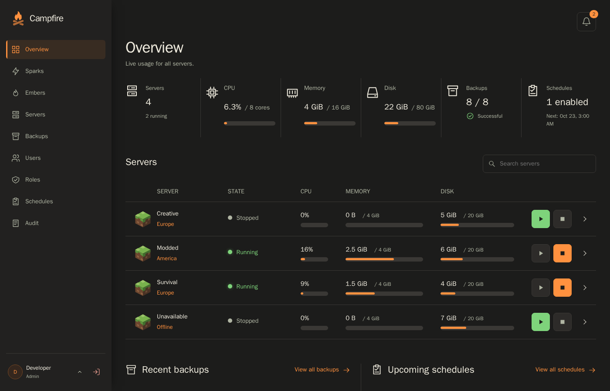
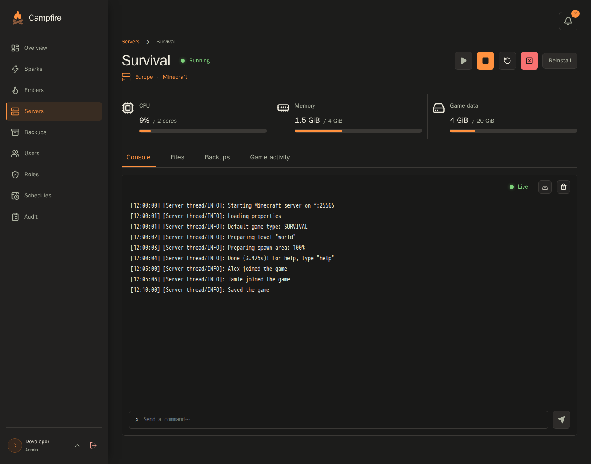
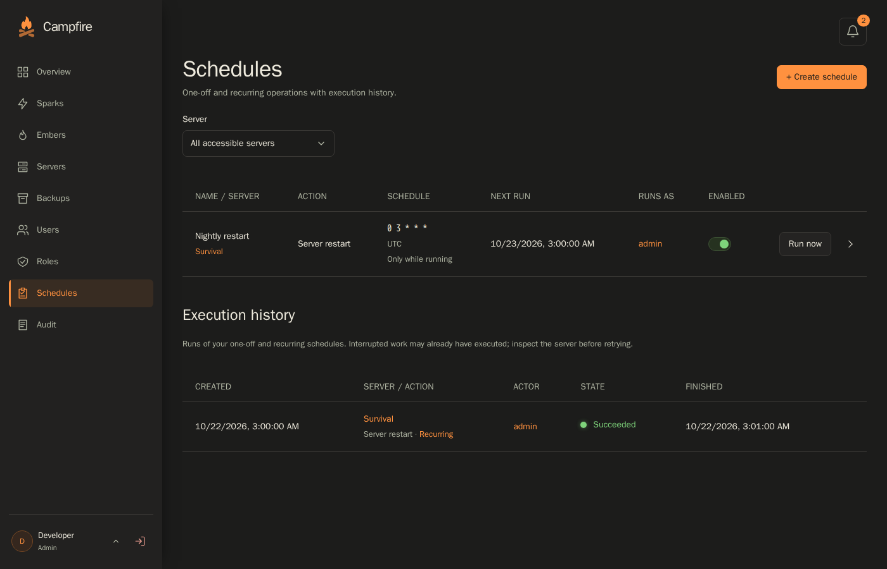
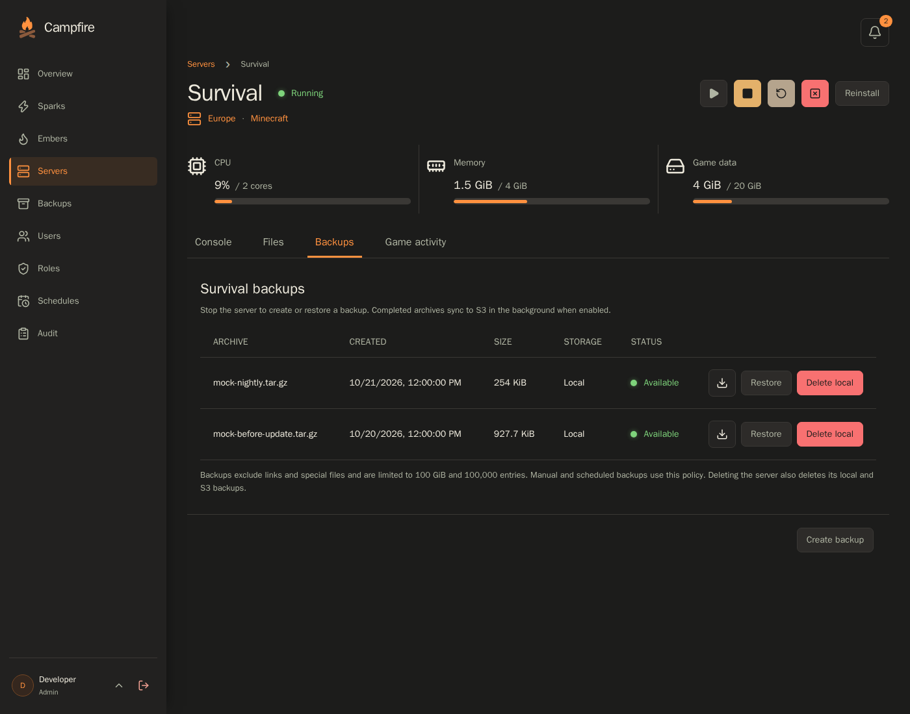

<p align="center">
  
</p>

<h1 align="center">Campfire</h1>

[](https://github.com/dougmaitelli/Campfire/actions/workflows/ci.yml)
[](https://github.com/dougmaitelli/Campfire/releases)
[](https://github.com/dougmaitelli/Campfire/pkgs/container/campfire)

Campfire is a self-hosted game server management panel. Run games across Linux hosts, stream their consoles, edit their files, manage backups, and give friends access to the servers they use—all from one web interface.

The panel manages accounts, permissions, configuration, and schedules. A separate **Spark** agent on each game host runs the Docker containers and connects back to the panel over authenticated TLS. Game definitions, called **Embers**, describe how to install, configure, and run each game; you can import native definitions or supported Pterodactyl and Pelican Eggs.

## Documentation

- [Docker Compose setup](#quick-start-with-docker-compose)
- [Linux binary setup](#linux-binary-installation)
- [Egg compatibility](docs/egg-compatibility.md) — supported imports and what to review
- [User guides](docs/README.md) — access, Sparks, files, and backups
- [Panel configuration](config/campfire.env.example)
- [Development](docs/development.md)

## Features

- **Multiple game hosts** — enroll Sparks, track their connection status, and allocate CPU, memory, disk, and game ports to servers
- **Game server controls** — install, start, stop, restart, and inspect background operations from the browser
- **Live console** — stream game and installer output and send commands to a running server
- **File management** — browse game files, edit text, upload and download files, and compress or extract archives
- **Optional SFTP gateway** — access game files through the panel using a personal API token and the same server permissions
- **Backups and restoration** — create and restore local snapshots, with optional S3-compatible off-host storage and per-server retention
- **Recurring schedules** — configure future server actions with execution history separate from direct operations
- **Ember imports and updates** — preview native definitions or supported Egg conversions, review warnings, and explicitly apply definition updates
- **Users and roles** — combine platform roles, server ownership, and server memberships to control access; inspect linked resources in drawers without leaving the current page
- **Authentication and API tokens** — local password accounts, optional OpenID Connect, and scoped, expiring personal tokens
- **Monitoring and notifications** — view live resource usage, receive sustained resource and health alerts, and optionally deliver notifications through Apprise
- **Audit history** — record administrative changes, authentication events, and operation outcomes with configurable retention
- **SQLite or PostgreSQL** — use an embedded database or an existing PostgreSQL service
- **Two deployment options** — run the panel in Docker or as a Linux binary; the production binary includes the web UI

## Screenshots

<table>
<tr>
<td width="50%">
<a href="screenshots/dashboard.png"></a>
<p><em>Overview — resource usage, allocations, and server status across your Sparks.</em></p>
</td>
<td width="50%">
<a href="screenshots/server-console.png"></a>
<p><em>Console — live game output and command input alongside server details.</em></p>
</td>
</tr>
<tr>
<td width="50%">
<a href="screenshots/schedules.png"></a>
<p><em>Schedules — recurring server actions and their execution history.</em></p>
</td>
<td width="50%">
<a href="screenshots/server-backups.png"></a>
<p><em>Server backups — inspect snapshots and storage availability from the console's Backups tab.</em></p>
</td>
</tr>
</table>

## How it fits together

| Component    | Responsibility                                                                    | Requirements                                            |
| ------------ | --------------------------------------------------------------------------------- | ------------------------------------------------------- |
| **Campfire** | Web UI, API, accounts, schedules, notifications, and Spark connections            | Persistent panel state; SQLite or PostgreSQL            |
| **Spark**    | Game containers, console streams, game files, and local backups                   | Linux game host with Docker Engine and CLI              |
| **Ember**    | A game's images, installation, startup, variables, ports, and configuration rules | Import and review in the panel before creating a server |

The panel runs without access to Docker. Every game host runs a separate Spark, including when the panel and games share one machine. Sparks initiate outbound management connections; game ports are exposed on the game host and must be reachable by players.

## Quick start with Docker Compose

Use the included [`compose.yaml`](compose.yaml) and [`.env.example`](.env.example), either from a release archive or a checkout:

```sh
git clone https://github.com/dougmaitelli/Campfire.git
cd Campfire
cp .env.example .env
```

Edit `.env` and set your panel's public URL:

```dotenv
CAMPFIRE_PUBLIC_URL=https://panel.example.com
```

Configure an HTTPS reverse proxy for your panel hostname, forwarding to `http://127.0.0.1:8080`. The supplied Compose file binds the browser port to loopback and separately publishes the Spark TLS listener on port `8443`.

```sh
docker compose pull
docker compose up -d
```

Open your configured HTTPS URL. On first startup, the logs contain a one-time administrator setup token. Enter it in the setup form, choose a username, and create a password of at least 15 characters. Restarting before setup completes generates a new token; use the latest startup output.

The panel generates and persists its Spark TLS certificates automatically. By default, agents connect to the panel hostname on port `8443`; set `CAMPFIRE_AGENT_PUBLIC_URL` if they need a different hostname or external port. This listener needs direct TLS or TCP passthrough, since Spark connections use client certificates. Configure your HTTP proxy to stream console responses without buffering.

To supply your own agent certificate, set `CAMPFIRE_TLS_DIR` to a directory containing `panel.crt` and `panel.key`, readable by container UID/GID `10001`. Start Compose with `-f compose.yaml -f compose.agent-tls.yaml`. Preserve the certificate authority trusted by enrolled Sparks when changing TLS settings.

### Add a game host

1. Prepare a Linux amd64 or arm64 host with Docker Engine and the Docker CLI. The guided installer also needs systemd, curl, base64, and sudo access.
2. Create a Spark on the **Sparks** page. Set its game address to an address players can reach.
3. Use the enrollment helper and run its generated installation command on that host. The command installs the matching Spark binary, enrolls its identity, and starts its systemd service.
4. Confirm that the Spark is connected in the panel. Allow its outbound connection to the panel's agent listener, and open the game ports players will use.

Enrollment tokens are single use and expire after 15 minutes. The helper supplies the generated CA trust; custom private certificates may need a CA file. After enrollment, Spark uses its saved identity for subsequent starts.

### Create a game server

1. Open **Embers** and import a native Ember or supported Pterodactyl/Pelican Egg. Review the image, installer, variables, and compatibility warnings.
2. Create a server, choose its Spark and Ember, assign resources and ports, and configure the game variables.
3. Install the server, then start it. Open its console to follow startup and send game commands.
4. Add server members, recurring schedules, and backups as needed.

An imported Egg is converted into a native Ember; successful conversion does not guarantee that its image or installer will run. The [compatibility guide](docs/egg-compatibility.md) explains what to review and how to handle import warnings.

## Linux binary installation

Download the release archive for Linux amd64 or arm64 and its companion checksum file. From the download directory, replace `VERSION` and `ARCH` below with the downloaded values:

```sh
sha256sum -c campfire_VERSION_linux_ARCH.tar.gz.sha256
tar -xzf campfire_VERSION_linux_ARCH.tar.gz
sudo install -m 0755 campfire /usr/local/bin/campfire
```

The panel host needs operating-system CA certificates. Game hosts also need rootful Docker Engine and the Docker CLI; use the panel's enrollment helper to install Spark.

For a systemd panel installation, run these commands from the extracted archive:

```sh
sudo useradd --system --home-dir /var/lib/campfire --shell /usr/sbin/nologin campfire
sudo install -d -m 0750 /etc/campfire
sudo install -m 0600 campfire.env.example /etc/campfire/campfire.env
sudo install -m 0644 deploy/systemd/campfire.service /etc/systemd/system/
```

Edit `/etc/campfire/campfire.env` to set `CAMPFIRE_PUBLIC_URL` to your HTTPS origin. Configure the reverse proxy and agent connectivity as described in the Docker setup, then start the panel:

```sh
sudo systemctl daemon-reload
sudo systemctl enable --now campfire
sudo journalctl -u campfire -b
```

Use the setup token from the journal to create the first administrator. The service persists state in `/var/lib/campfire` and listens for browser traffic at `127.0.0.1:8080`. Continue with [adding a game host](#add-a-game-host).

## Configuration

Command-line flags override environment values. The configuration examples list the available settings; the main deployment choices are:

| Setting                                                                          | Purpose                                                                                       |
| -------------------------------------------------------------------------------- | --------------------------------------------------------------------------------------------- |
| `CAMPFIRE_PUBLIC_URL`                                                            | Browser-visible HTTPS origin                                                                  |
| `CAMPFIRE_DATABASE`                                                              | SQLite file path or PostgreSQL connection URL                                                 |
| `CAMPFIRE_DATA`                                                                  | Persistent panel identities, certificates, and SFTP host key                                  |
| `CAMPFIRE_AGENT_PUBLIC_URL`                                                      | Spark connection URL when different from the default hostname and port                        |
| `CAMPFIRE_OIDC_ISSUER`, `CAMPFIRE_OIDC_CLIENT_ID`, `CAMPFIRE_OIDC_CLIENT_SECRET` | Optional OpenID Connect provider                                                              |
| `CAMPFIRE_DISABLE_LOCAL_LOGIN`                                                   | Require OIDC after an administrator has been linked                                           |
| `CAMPFIRE_SFTP_LISTEN`                                                           | Enable the optional SFTP listener; publish its TCP port separately                            |
| `CAMPFIRE_MAX_UPLOAD_MIB`                                                        | Per-file browser and SFTP upload limit; defaults to 1024 MiB                                  |
| `CAMPFIRE_S3_BUCKET`, `CAMPFIRE_S3_REGION`, `CAMPFIRE_S3_ENDPOINT`               | Optional off-host backup storage                                                              |
| `CAMPFIRE_ALERT_CPU_PERCENT`                                                     | CPU alert threshold relative to the server allocation; defaults to `90`, or `0` to disable    |
| `CAMPFIRE_ALERT_MEMORY_PERCENT`                                                  | Memory alert threshold relative to the server allocation; defaults to `90`, or `0` to disable |
| `CAMPFIRE_ALERT_DISK_PERCENT`                                                    | Disk alert threshold relative to the server allocation; defaults to `90`, or `0` to disable   |
| `CAMPFIRE_ALERT_DURATION_SECONDS`                                                | How long an alert or recovery condition must persist; defaults to `120` seconds               |
| `CAMPFIRE_ALERT_INTERVAL_SECONDS`                                                | Monitoring interval; defaults to `30` seconds                                                 |
| `CAMPFIRE_ALERT_HEALTH_ENABLED`                                                  | Enable Spark connection and server health alerts; defaults to `true`                          |
| `CAMPFIRE_APPRISE_URL`, `CAMPFIRE_APPRISE_TAGS`, `CAMPFIRE_APPRISE_URLS`         | Optional external notification delivery                                                       |
| `CAMPFIRE_AUDIT_RETENTION_DAYS`, `CAMPFIRE_OPERATION_RETENTION_DAYS`             | Independent history retention; `0` keeps records indefinitely                                 |

The base Compose file forwards the settings shown in [`.env.example`](.env.example). For additional settings such as S3 storage, add the corresponding environment entries to your Compose service using the [full panel example](config/campfire.env.example). S3 credentials use the AWS SDK credential chain and stay on the panel; enable backup synchronization and retention separately for each server.

SQLite is the default. To use PostgreSQL, create a dedicated database and set `CAMPFIRE_DATABASE` to its connection URL. Keep `CAMPFIRE_DATA` persistent with either backend: the database does not contain the panel's private signing authority. Run one active panel process per installation.

## Authentication

First-run setup creates the initial administrator. Administrators add password accounts from **Users** and manage built-in or custom roles from **Roles**. Server owners and memberships determine access to individual servers. There is no public password registration.

For OIDC, register `https://panel.example.com/api/v1/auth/oidc/callback` with your provider. Complete initial setup and link an administrator before disabling local login. Personal API tokens remain available for both local and OIDC users; their scopes restrict the user's current permissions.

Create and revoke personal tokens through **API tokens** in the account menu. See [accounts and access](docs/authentication.md) for role assignments, OIDC setup, and token usage.

## Security and storage

Campfire can control game processes and modify game data. Protect browser access with HTTPS and grant users only the permissions they need. Treat imported game images and installation scripts as executable code to review before running.

The supplied panel container runs as UID/GID `10001`, with a read-only root filesystem, dropped capabilities, and no Docker socket. Spark runs with the privileges needed to manage Docker and game file ownership. Keep its state on the Docker execution host, and protect both panel and Spark identity files.

Disk usage is measured on Spark. Hard game-data limits require Linux 5.14 or newer and XFS or ext4 with project quota accounting and enforcement enabled on the filesystem holding `SPARK_DATA/runtime`. XFS needs the `prjquota` or `pquota` mount option; ext4 also needs its project and quota filesystem features. Prepare the filesystem before starting Spark, and restart Spark after changing quota support. Without supported quotas, usage is monitored but hard disk limits are unavailable.

Game-data allocations do not include backup archives, Docker images, or container writable layers, so host storage still needs separate capacity management.

## Backups and upgrades

Game snapshots and installation recovery protect different data. Preserve:

- The panel database and its persistent state directory, including the Spark signing authority
- Each Spark's identity, runtime metadata, game data, and backup archives
- Any separately configured S3 backups and their retention settings

Before upgrading, stop the panel and take a consistent database and state backup. For SQLite, copying only a live database file can omit WAL contents. For PostgreSQL, back up the database as well as the panel state directory.

Run `docker compose pull` and `docker compose up -d` to upgrade to the latest release. If you pinned a release with `CAMPFIRE_VERSION`, update that value first. Check login, health, and Spark connections afterward. Upgrade Spark when required by protocol or feature compatibility; wait for active operations to finish before restarting an agent.

For binary upgrades, stop the relevant service, replace its binary with the verified new release, and restart it. Preserve the previous binary until verification succeeds. Database migrations run at startup; a rollback may require restoring the matching pre-upgrade database and state as well as the previous image or binary. Do not use `docker compose down -v` during upgrades: it deletes persistent volumes.

### Administrator password recovery

Save a new password of at least 15 characters in a private, mode-`0600` regular file. On a binary installation, run:

```sh
sudo campfire reset-password \
  --database /var/lib/campfire/panel.db \
  --password-file /private/new-password
```

For Docker, place the file in the container's writable data directory, readable only by its UID `10001`, then run:

```sh
docker compose exec campfire campfire reset-password \
  --password-file /var/lib/campfire/new-password
```

Use your configured database path or PostgreSQL URL for binary installations. Add `--username NAME` to select an administrator; otherwise the first administrator is recovered. Recovery revokes that account's sessions. Remove temporary password files afterward. If local login is disabled, re-enable it in your deployment configuration before signing in with the recovered password.

## Support

Use [GitHub issues](https://github.com/dougmaitelli/Campfire/issues) for reproducible bugs and feature requests. Include the Campfire and Spark versions, relevant deployment details, and logs with credentials and enrollment tokens removed.
